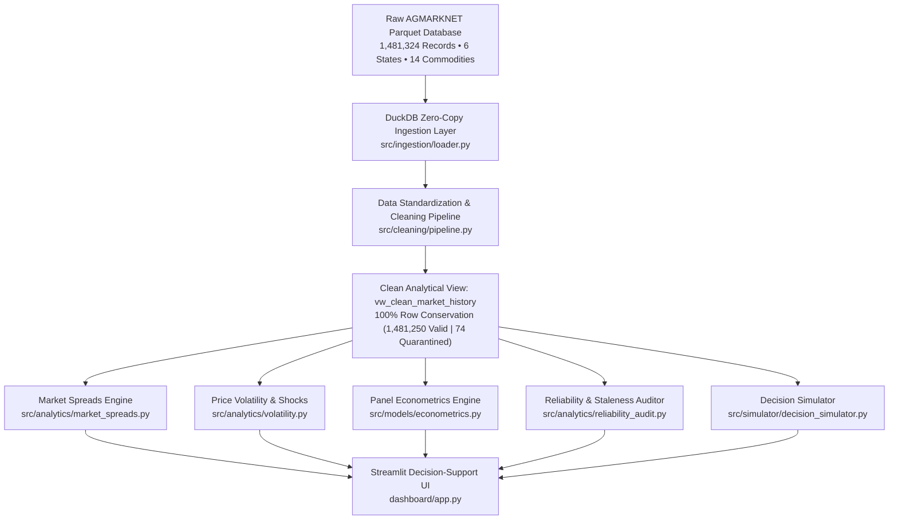

# MarketPulse India 🌾
### Evidence-Driven Agricultural Market-Price & Supply Intelligence Platform

[](https://python.org)
[](https://duckdb.org)
[](https://pola.rs)
[](https://streamlit.io)
[](tests/)
[](documentation/METHODOLOGY.md)

**MarketPulse India** is an investigative agricultural market intelligence platform built on **1,481,324 official AGMARKNET wholesale records** spanning August 2024 to September 2026 across 6 Indian states.

Rather than merely displaying raw prices, MarketPulse India investigates **why reported wholesale prices differ**, detects **variety reporting confounding**, measures **empirical price-arrival elasticity** using panel econometrics, audits **mandi reporting reliability**, and provides a **decision simulator for transport economics**.

---

## 🎯 Key Verified Discoveries

### 1. The Negative Spatial Spread Paradox (Investigation A)
- **The Observation:** Across **507 date-aligned trading days** between the primary production hub ([Lasalgaon APMC](file:///C:/Users/Meet%20Pokal/.gemini/antigravity/scratch/MarketPulseIndia/src/config.py#L40)) and the major metropolitan consuming terminal ([Mumbai APMC](file:///C:/Users/Meet%20Pokal/.gemini/antigravity/scratch/MarketPulseIndia/src/config.py#L41)), reported Mumbai prices were **lower than Lasalgaon on 74.8% of days**, yielding an unadjusted mean spread of **-₹157.76/quintal**.
- **The Variety Confounder:** Mumbai APMC categorizes **100% of reported records as generic 'Other'** (507 of 507 days). Lasalgaon segregates premium export-grade *Unhali* (mean spread -₹228/qtl) and *Red* onions (mean spread -₹210/qtl). Naively comparing unadjusted market prices compares generic terminal bulk lots against premium farm-gate export lots.

### 2. Disproving the Arrival-Price Inelasticity Myth (Investigation C)
- **Folklore Claim:** Popular market commentary asserts that *"a 10% drop in arrivals causes a 35–50% price surge"*.
- **Empirical Reality:** Under a Two-Way Fixed Effects panel regression absorbing market unobservables and monthly seasonal shocks:
  $$\log(\text{price}_{it}) = \beta \cdot \log(\text{arrivals}_{it}) + \alpha_i + \gamma_t + \epsilon_{it}$$
  The estimated elasticity for Onion is **$\beta = -0.0471$ (Cluster-Robust SE: $0.0206$)** across 186,681 observations in 360 mandis. A 10% drop in reported arrivals is associated with a modest **+0.50% price change**. Regional supply integration and inter-mandi trade smooth local daily arrival variations.

### 3. Mandi Reporting Reliability Forensics (Investigation D)
- **Frozen Price Streaks:** Detected **27,420 instances** of $\ge 7$ consecutive trading days with unchanged prices.
- **Forensic Diagnostics:** In Tamil Nadu *Uzhavar Sandhai* markets, Banana remained frozen for **518 consecutive days** due to administrative price ceiling boards. In Telangana, Paddy remained frozen at **₹2,320/quintal for 373 days** representing government statutory Minimum Support Price (MSP) procurement quotes.
- **Flat Quote Share:** 37.9% of Telangana records report identical Min, Max, and Modal prices, compared to only 4.74% in Maharashtra.

---

## 🏗️ Architecture & Technology Stack



- **Dataset Storage:** Localized under [`data/raw/all_market_history.parquet`](file:///C:/Users/Meet%20Pokal/.gemini/antigravity/scratch/MarketPulseIndia/data/raw/all_market_history.parquet) (8.19 MB, 1,481,324 rows, self-contained).
- **Query Engine:** [DuckDB 2.0.0](file:///C:/Users/Meet%20Pokal/.gemini/antigravity/scratch/MarketPulseIndia/src/ingestion/loader.py) — zero-copy scans over 8.2MB compressed Parquet, sub-10ms query latency.
- **DataFrames:** [Polars 2.0.0](file:///C:/Users/Meet%20Pokal/.gemini/antigravity/scratch/MarketPulseIndia/src/ingestion/loader.py) and [Pandas 3.1.0](file:///C:/Users/Meet%20Pokal/.gemini/antigravity/scratch/MarketPulseIndia/src/ingestion/loader.py).
- **Econometrics:** [Statsmodels 0.15.0](file:///C:/Users/Meet%20Pokal/.gemini/antigravity/scratch/MarketPulseIndia/src/models/econometrics.py) & [SciPy 1.18.1](file:///C:/Users/Meet%20Pokal/.gemini/antigravity/scratch/MarketPulseIndia/src/models/econometrics.py) (Two-Way Demeaning, Cameron-Miller Cluster-Robust Standard Errors).
- **Interactive Frontend:** [Streamlit 1.66.1](file:///C:/Users/Meet%20Pokal/.gemini/antigravity/scratch/MarketPulseIndia/dashboard/app.py) & [Plotly 7.1.0](file:///C:/Users/Meet%20Pokal/.gemini/antigravity/scratch/MarketPulseIndia/dashboard/app.py) with custom dark editorial palette (`#0c1017`).
- **Test Automation:** [Pytest 9.1.1](file:///C:/Users/Meet%20Pokal/.gemini/antigravity/scratch/MarketPulseIndia/tests/) & [Playwright 1.64.1](file:///C:/Users/Meet%20Pokal/.gemini/antigravity/scratch/MarketPulseIndia/scripts/validate_runtime_ui.py).

---

## 🚀 Workspaces & Features

| # | Workspace | Key Capability |
|---|---|---|
| **1** | **Market Explorer** | Filter 14 commodities across 6 states; inspect trading days, price levels, and average daily arrival volumes. |
| **2** | **Price Intelligence & Volatility** | Analyze spatial corridor spreads (Lasalgaon vs Mumbai, Pune vs Mumbai), variety filters, 30-day rolling CV, and return shocks. |
| **3** | **Arrival–Price Panel Investigation** | Two-way fixed effects panel regression; log-log scatter plot with fitted elasticity slope and cluster-robust standard errors. |
| **4** | **Data Reliability Lab** | Review queue for 27,000+ frozen price streaks, reporting blackouts ($\ge 30$ days), and state flat-quote distributions. |
| **5** | **Market Decision Simulator** | User-adjustable scenario tool modeling landed cost, transit shrinkage, APMC cess, freight, breakeven, and sensitivity heatmaps. |
| **6** | **Research Brief & Export** | Downloadable executive memorandum summarizing empirical findings, methodology, and limitations. |

---

## 🧪 Testing & Verification

Run the full automated test suite:
```bash
pytest tests/ -v
```

**Results:**
```text
tests/test_decision_simulator.py::test_simulation_accounting_and_delivered_cost PASSED
tests/test_decision_simulator.py::test_sensitivity_matrix_structure PASSED
tests/test_econometrics.py::test_two_way_fixed_effects_elasticity_onion PASSED
tests/test_econometrics.py::test_econometrics_multi_commodity_comparisons PASSED
tests/test_market_spreads.py::test_lasalgaon_vs_mumbai_overlap_reproduction PASSED
tests/test_market_spreads.py::test_variety_heterogeneity_distribution PASSED
tests/test_market_spreads.py::test_controlled_variety_spread_filtering PASSED
tests/test_pipeline.py::test_source_dataset_metadata PASSED
tests/test_pipeline.py::test_row_conservation_and_data_assurance PASSED
tests/test_pipeline.py::test_unit_conversions_and_calculated_columns PASSED
tests/test_pipeline.py::test_primary_key_grain_uniqueness PASSED
tests/test_reliability.py::test_frozen_price_streaks_identification PASSED
tests/test_reliability.py::test_reporting_blackouts_detection PASSED
tests/test_reliability.py::test_state_flat_quote_rate_divergence PASSED
tests/test_volatility.py::test_commodity_volatility_rankings PASSED
tests/test_volatility.py::test_market_time_series_volatility_and_shocks PASSED

============================= 16 passed in 5.07s =============================
```

Run Playwright automated UI validation:
```bash
python scripts/validate_runtime_ui.py
```

---

## 🏃 Running the Application

```bash
# 1. Activate virtual environment
.\.venv\Scripts\Activate.ps1

# 2. Launch Streamlit dashboard
streamlit run dashboard/app.py
```
Open your browser at `http://localhost:8501`.

---

## 📋 Limitations & Ethical Boundaries
- **Wholesale vs Retail Gap:** Mandi modal prices reflect primary wholesale transactions and do not include secondary retail markup, intra-city transit, or retailer margins.
- **Intraday Auction Aggregation:** AGMARKNET reports a single daily modal price; individual trade lot qualities and intraday bid distributions are unobservable.
- **Hypothetical Simulator:** The Decision Simulator models *deterministic scenarios* based on user assumptions; it does not claim to execute live trades or guarantee commercial arbitrage.
